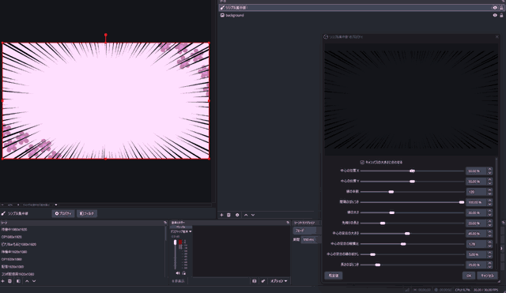

# シンプル集中線 / Simple Burst Lines

OBS Studio 向けの、動く集中線を描くシンプルな入力ソースのプラグインです。

A simple input source plugin for OBS Studio that draws animated burst lines.

[配信プラグイン倉庫くん](https://soko-kun.allegromoltov.jp/plugins/allegromoltov/obs-simple-burst-lines) にも掲載しています。 / Also listed on [Plugin Soko-kun](https://soko-kun.allegromoltov.jp/plugins/allegromoltov/obs-simple-burst-lines?lang=en).



## Features / 機能

漫画の集中線のように、画面の中心へ向かう線を描く入力ソースです。線の配置を一定の間隔で描き替えるため、動画素材のように動いて見えます。線の本数・太さ・中心の空白・色などを、OBS の設定画面で配信の場で調整できます。描画はすべて GPU のシェーダーで行い、1920×1080 で 1 フレームあたり約 0.04ms の GPU 時間です (RTX 3060 Ti で測定)。

An input source that draws lines converging on a center point, like manga focus lines. The line layout is redrawn at a fixed rate, so the lines move like a video overlay. You can adjust the number of lines, width, empty center, color, and more in the OBS properties while streaming. All drawing runs in a GPU shader and takes about 0.04 ms of GPU time per frame at 1920×1080 (measured on an RTX 3060 Ti).

- **Center X / Y・中心の位置 X・Y** - 線が集まる点
- **Number of lines・線の本数** - 一周あたりの線の数
- **Spacing variation・間隔のばらつき** - 線の間隔の不ぞろいさ
- **Line width・線の太さ** - 線 1 本の太さ
- **Taper length・先細りの長さ** - 線の内側の端を細くする長さ
- **Empty center size / aspect ratio / edge softness・中心の空白の大きさ・縦横比・縁のぼかし** - 線を描かない中央の楕円
- **Length variation・長さのばらつき** - 線ごとの内側の端の不ぞろいさ
- **Color・線の色** - 線の色と不透明度
- **Redraws per second・1 秒あたりの描き替え** - 線の配置を描き替える頻度
- **Random seed・乱数のシード** - 線の配置の乱数の種

## Installation / インストール

### Windows

Windows 版は OBS Studio 33 以降向けです。OBS Studio 33.0.1 で、新規導入、再起動後の設定の保持、集中線の描画を確認しています。

#### 通常版 OBS への導入

プラグインを OBS Studio の共通プラグインフォルダーへ配置します。

1. OBS Studio を終了してください。
2. [Releases](../../releases) から Windows 用の zip ファイルをダウンロードし、展開してください。
3. エクスプローラーのアドレスバーへ `%PROGRAMDATA%` を入力し、Enter キーを押してください。隠しフォルダーの表示設定を変更する必要はありません。
4. `obs-studio` フォルダーを開き、その中の `plugins` フォルダーを開いてください。存在しないフォルダーは順に作成してください。
5. 展開した `simple-burst-lines` フォルダーを `plugins` へコピーしてください。管理者の許可を求められた場合は許可してください。
6. OBS Studio を起動し、ソースの「+」からシンプル集中線を追加してください。

導入後の構成を次に示します。`simple-burst-lines` フォルダーを二重に作らないでください。PDB ファイルが同梱されている場合も、製品フォルダーごとコピーします。

```text
%PROGRAMDATA%\obs-studio\plugins\
└─ simple-burst-lines\
   ├─ simple-burst-lines.dll
   └─ data\
      ├─ effects\burst-lines.effect
      └─ locale\
         ├─ en-US.ini
         └─ ja-JP.ini
```

更新するときは、OBS Studio を終了し、同じ手順で `simple-burst-lines` フォルダーを上書きコピーしてください。設定やシーンは削除しないでください。

#### ポータブル版 OBS

ポータブル版では、OBS Studio のルートフォルダーにある `plugins` へ製品フォルダーをコピーします。通常版の `%PROGRAMDATA%` への導入では読み込まれません。

OBS Studio を終了し、`bin` や `data` と同じ階層に `plugins` フォルダーを作成してください。展開した製品フォルダーをコピーし、`plugins\simple-burst-lines\simple-burst-lines.dll` と `plugins\simple-burst-lines\data` を配置してから OBS Studio を起動します。

### macOS / Linux

macOS / Linux 向けのビルドは GitHub Actions で生成しています。GitHub Actions 上の Ubuntu 24.04 (Mesa の OpenGL) と macOS 15 (OpenGL) で、集中線の描画を自動で検証しています。作者は macOS と Linux の実機を持たないため、実機の GPU と OBS Studio では動作を確認していません。macOS の OBS Studio 32 以降で選べる試験的な Metal 描画も確認していません。ソースからのビルドは「Build / ビルド」を参照してください。

## Usage / 使い方

1. OBS Studio を起動
2. ソースの **+** ボタン → **Simple Burst Lines** (または **シンプル集中線**) を追加
3. プロパティでパラメータを調整
4. ソースの一覧で、集中線を重ねたい映像より上に置く

配信中に集中線を出し入れするには、OBS Studio 本体の機能を使います。

- **ホットキー**: 設定 → ホットキー で、シーン名の見出しの下にある、このソースの表示と非表示の項目にキーを割り当てます。
- **フェード**: ソースを右クリック → 表示トランジション・非表示トランジション に「フェード」を設定すると、表示と非表示の切替えがフェードします。

To show or hide the lines while streaming, use OBS Studio's built-in features. Assign keys to the show and hide items for this source under the scene's heading in Settings → Hotkeys. To fade the lines in and out, right-click the source and set Show Transition and Hide Transition to Fade.

## Parameters / パラメータ

長さの割合は、すべてソースの対角線の半分に対する割合です。

Lengths are percentages of half the source's diagonal.

| Parameter | 日本語 | Range | Default |
|-----------|--------|-------|---------|
| Match canvas size | キャンバスの大きさに合わせる | On / Off | On |
| Width / Height | 幅・高さ | 16 ~ 8192 | 1920 / 1080 |
| Center X / Y | 中心の位置 X・Y | 0% ~ 100% | 50% |
| Number of lines | 線の本数 | 8 ~ 400 | 120 |
| Spacing variation | 間隔のばらつき | 0% ~ 100% | 100% |
| Line width | 線の太さ | 1% ~ 100% | 30% |
| Taper length | 先細りの長さ | 0% ~ 100% | 20% |
| Empty center size | 中心の空白の大きさ | 0% ~ 100% | 45% |
| Empty center aspect ratio | 中心の空白の縦横比 | 0.25 ~ 4 | 1.78 |
| Empty center edge softness | 中心の空白の縁のぼかし | 0% ~ 50% | 5% |
| Length variation | 長さのばらつき | 0% ~ 100% | 15% |
| Color | 線の色 | - | Black |
| Redraws per second | 1 秒あたりの描き替え | 0 ~ 60 | 12 |
| Random seed | 乱数のシード | 0 ~ 9999 | 0 |

幅と高さは、「キャンバスの大きさに合わせる」をオフにしたときに使います。線の太さは、線 1 本が受け持つ角度の幅に対する割合です。中心の空白の縦横比は 1 で円、1 より大きいと横長の楕円になります。1 秒あたりの描き替えを 0 にすると、線は止まります。

## Known Behavior / 既知の挙動

- 1 秒あたりの描き替えは、OBS Studio のフレームレートを上限とします。フレームレートが 30 の場合、30 より大きい値は毎フレームの描き替えと同じになります。
- 同じ設定と乱数のシードでも、線の配置は描画方式 (Direct3D 11 と OpenGL) や環境によってわずかに違います。
- 「キャンバスの大きさに合わせる」がオンのとき、ソースの大きさは OBS Studio の基本 (キャンバス) 解像度に従います。解像度を変えると、ソースの大きさも変わります。

## Build / ビルド

### Requirements / 必要環境

| Platform | Tool |
|----------|------|
| Windows | Visual Studio 17 2022 |
| Windows | CMake 3.28+ |
| macOS | Xcode 16.0, CMake 3.28+ |
| Ubuntu 24.04 | ninja-build, pkg-config, build-essential, CMake 3.28+ |

### Build Commands / ビルドコマンド

```bash
# Windows
cmake --preset windows-x64 -DENABLE_POST_BUILD_INSTALL=OFF
cmake --build build_x64 --config RelWithDebInfo

# macOS
cmake --preset macos
cmake --build build_macos --config RelWithDebInfo

# Ubuntu
cmake --preset ubuntu-x86_64
cmake --build build_x86_64 --config RelWithDebInfo
```

Windows で生成物を取り出すには、`cmake --install build_x64 --config RelWithDebInfo --prefix release/RelWithDebInfo` を実行してください。生成した製品フォルダーを前述の手順で導入してください。

Windows では、描画の統合テストを Direct3D 11 と OpenGL の両方で CTest に登録しています。OBS のグラフィックスの DLL を `cmake --build .deps/obs-studio-31.1.1/build_x64 --config Release --target libobs-d3d11 libobs-opengl` で作ってから、`ctest --test-dir build_x64 -C RelWithDebInfo` を実行してください。

## AI利用開示 / AI Disclosure

### 日本語

v1.0.0 の制作では、Anthropic Claude Code を、調査、ソースコード、ビルド設定、テスト、文書を含むほぼすべての工程で使用しました。リソースアイコンは、Claude Code が作成したスクリプトで生成した SVG の案から、作者本人が選びました。

作者本人は Windows 上の OBS Studio でユーザーテストを実施しました。コード読解による厳密な人間レビューは実施していません。概要説明欄のアニメーション GIF は、作者本人が ScreenToGif で画面収録したもので、生成 AI を使用していません。容量を収めるための縮小は、Claude Code が ffmpeg で行いました。

### English

Anthropic Claude Code was used for almost the entire development process of v1.0.0, including research, source code, build configuration, tests, and documentation. The resource icon was chosen by the author from SVG candidates generated by a script that Claude Code wrote.

The author performed user testing in OBS Studio on Windows but did not perform a rigorous human review of the source code. The animated GIF in the description was screen-recorded by the author using ScreenToGif, without generative AI. Claude Code reduced its file size with ffmpeg.

## License / ライセンス

GPL-2.0 License

このプラグインは [obs-plugintemplate](https://github.com/obsproject/obs-plugintemplate) をベースにしています。

## Author / 作者

AllegroMoltoV - https://www.allegromoltov.jp

## Changelog / 更新情報

### v1.0.2

- 配信プラグイン倉庫くんに表示名と載せる OS を伝える宣言ファイル (.soko-kun/config.json) を足しました。macOS と Linux の配布物は動作を確かめていないため、倉庫くんには Windows の配布物だけを載せます。README の題名から OBS を外しました。リポジトリの名前を obs-simple-burst-lines から simple-burst-lines に変えました。プラグインの動作は v1.0.1 と同じです。

### v1.0.1 (2026-11-13)

- リリースの配布物にビルドの来歴の証明 (GitHub Artifact Attestation) を付けるようにしました。プラグインの動作は v1.0.0 と同じです。

### v1.0.0 (2026-11-10)

- 最初の公開版です。
